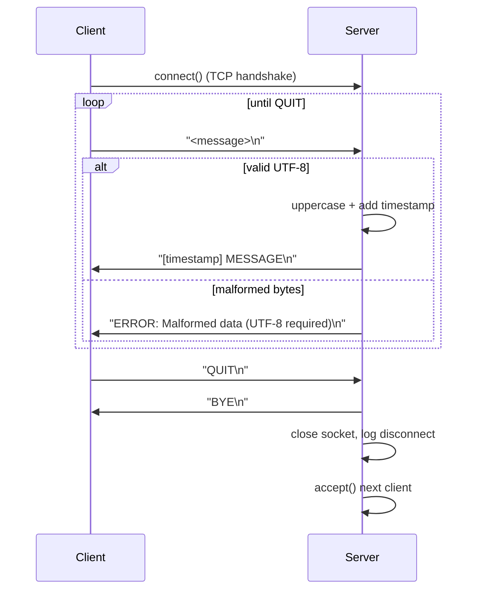

# Lab 1 Report — TCP Client/Server in Python

## 1. Architecture

A single-threaded, sequential TCP server accepts one client connection at a time. Each client exchanges newline-delimited text messages with the server until it sends `QUIT`.

Because the server calls `accept()` in a loop and handles one client fully before looping back, clients are served **sequentially** — which is exactly what `test_sequential.py` exercises with 5 clients in a row.

## 2. Protocol: Echo+

- Transport: TCP, `socket.SOCK_STREAM`
- Framing: messages are delimited by `\n`; both sides buffer partial reads until a full line arrives (`receive_line()` in the client, the inner `while "\n" in buffer` loop in the server)
- Response: the received line, uppercased, prefixed with a `[YYYY-MM-DD HH:MM:SS]` receipt timestamp
- Termination command: `QUIT` — server replies `BYE\n` and closes the connection; client prints a confirmation and closes its socket

## 3. Error Handling

| # | Scenario | Detection | Response |
|---|---|---|---|
| 1 | Requested port already bound | `OSError` on `bind()` | Server logs a critical error with the reason and exits instead of crashing |
| 2 | Client disconnects without `QUIT` (killed process, network drop) | `recv()` returns empty bytes | Server logs a warning, closes that client's socket, keeps listening |
| 3 | Connection reset mid-exchange | `ConnectionResetError` | Caught on both client and server, logged/printed, resources released |
| 4 | Server process dies while client is sending | `BrokenPipeError` on client `sendall()` | Client catches it, prints a network-lost message, closes its socket |
| 5 | Malformed / non-UTF-8 bytes received | `UnicodeDecodeError` on `decode("utf-8")` | Server replies with an `ERROR:` line and keeps the connection open (does not treat it as fatal) |
| 6 | Server not running when client starts | `ConnectionRefusedError` on `connect()` | Client prints a friendly "is the server running?" message |
| 7 | Manual interruption (Ctrl+C) | `KeyboardInterrupt` | Both sides close their sockets cleanly before exiting |

## 4. Testing — 5 Sequential Clients

`test_sequential.py` opens 5 clients one after another against the running server. For each client it sends its scripted messages, reads the server's line back, and closes the socket before the next client connects — confirming the server correctly frees the port/socket between sessions.

**[Insert screenshot here: server console log showing all 5 clients connecting and disconnecting in order]**

**[Insert screenshot here: `test_sequential.py` console output showing each client's sent messages and the server's uppercased+timestamped replies]**

**[Optional: insert screenshot here demonstrating one error case, e.g. running `client.py` with the server stopped, or sending a message and then killing the server mid-session]**

## 5. Conclusion

The implementation satisfies all lab requirements: a standard-library-only TCP server/client pair, the Echo+ protocol with timestamped uppercase replies, a graceful `QUIT` handshake, handling for the required error classes (unavailable port, dropped connection, malformed data), and sequential testing with 5 clients via `test_sequential.py`.
